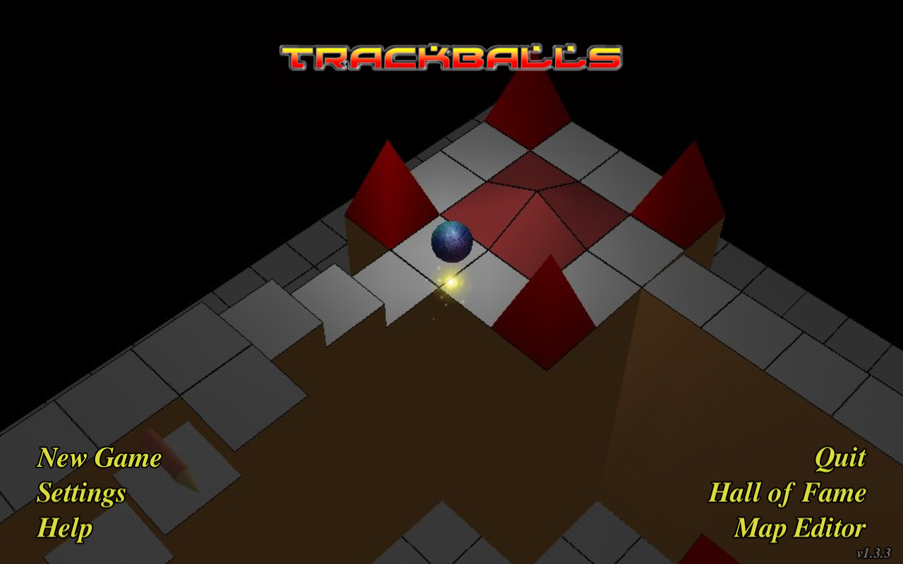
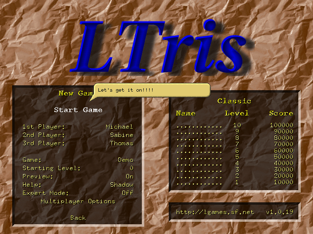

# Tested Free Games for Ubuntu

Free and open-source games that we actually installed and ran, with dated results, screenshots from the test run, exact package versions, controls and known issues. Not another link list: every entry below was executed by us on the date shown.

Current scope: Ubuntu 22.04 LTS (Jammy), x86-64, packages from the official Ubuntu `universe` repository. First edition: 12 games, tested **7 November 2026**.

## How we test

For each game:

1. We resolve the full dependency closure with apt's own resolver (`apt-get install --download-only --print-uris`), so the packages tested are exactly the ones `sudo apt install` would fetch.
2. We extract the packages and run the game against them in an isolated filesystem namespace (overlayfs over the stock system) on Ubuntu 22.04.5 LTS, with a virtual display (Xvfb, 1280x800x24) and no audio device.
3. We capture screenshots from the live run and record whether the process stayed up, whether the screen responded to keyboard/mouse input, and anything that broke.
4. We audit the package's maintainer scripts (postinst etc.) for install-time actions.

Honest limits:

- We did **not** run a literal `sudo apt install` on a desktop machine. The packages and closures are apt's own; the maintainer scripts we audited only seed high-score files and menu entries, so a real install does the same thing plus those trivial steps.
- No physical GPU and no sound card in the test environment. 3D games rendered in software; audio was disabled. Performance on real hardware will be better than anything you see here.
- Automated input (xdotool), not a human player. Where we say "input verified", we mean the screen changed in response to simulated keys/clicks. We do not claim anyone played a level to completion.
- Nothing here is a guarantee about other Ubuntu versions, Wayland sessions, or your hardware. It's a dated record of what ran, where, and how.

## Evidence levels

| Level | Meaning |
|---|---|
| **Gameplay screen reached** | Menus passed; an actual level/game screen rendered (start of play, attract/demo mode, or in-game view). |
| **Menu interaction verified** | Menu or intro screens visibly responded to simulated keyboard/mouse input. |
| **Launch verified** | Game launched, rendered its real menu/graphics, and stayed running. Input not exercised. |

## The games

| Game | Genre | Install | Version tested | Evidence |
|---|---|---|---|---|
| [Freedoom Phase 2 (Crispy Doom)](#freedoom-phase-2--crispy-doom) | FPS | `sudo apt install crispy-doom freedoom` | 0.12.1 / engine 5.11.1 | **Gameplay screen reached** |
| [Nebulus (Toppler)](#nebulus-toppler) | Tower platform action | `sudo apt install toppler` | 1.3-1 | **Gameplay screen reached** (demo) |
| [Trackballs](#trackballs) | Marble-rolling 3D | `sudo apt install trackballs` | 1.3.3-1 | **Gameplay screen reached** |
| [LTris](#ltris) | Falling-block puzzle | `sudo apt install ltris` | 1.0.19-3build1 | **Menu interaction verified** |
| [Alex the Allegator 4](#alex-the-allegator-4) | Platform | `sudo apt install alex4` | 1.1-9 | **Menu interaction verified** (intro) |
| [Ceferino](#ceferino) | Arcade platform | `sudo apt install ceferino` | 0.97.8+svn37-2build1 | **Menu interaction verified** (intro) |
| [Powermanga](#powermanga) | Shoot 'em up | `sudo apt install powermanga` | 0.93.1-4 | **Launch verified** (menu rendered) |
| [MadBomber](#madbomber) | Arcade catcher | `sudo apt install madbomber` | 0.2.5-8.1 | **Launch verified** |
| [Vodovod](#vodovod) | Pipe puzzle | `sudo apt install vodovod` | 1.10-5 | **Launch verified** |
| [Fillets-NG](#fillets-ng) | Logic puzzle | `sudo apt install fillets-ng` | 1.0.1-4build2 | **Launch verified** |
| [BlockOut II](#blockout-ii) | 3D falling-block puzzle | `sudo apt install blockout2` | 2.5+dfsg1-1build1 | **Launch verified** |
| [Pingus](#pingus) | Lemmings-style puzzle | `sudo apt install pingus` | 0.7.6-5.1 | **Launch verified** |

---

### Freedoom Phase 2 / Crispy Doom

A complete free-content campaign for Doom II, played through the Crispy Doom engine.

- **Install:** `sudo apt install crispy-doom freedoom`, then run `crispy-doom -iwad /usr/share/games/doom/freedoom2.wad` (or the `freedoom2` launcher).
- **Licence:** game data BSD-3-Clause; engine GPL-2.0+.
- **Tested:** freedoom 0.12.1-2 with crispy-doom 5.11.1-1. Launched, menu responded to keys, and the engine loaded MAP15 and entered the first-person level view with HUD. Sound initialised (dummy driver).
- **Controls:** standard Doom layout (arrows to move, Ctrl to fire, Space to use, Shift to run); configurable with `crispy-setup`.
- **Upstream:** https://freedoom.github.io/ and https://github.com/fabiangreffrath/crispy-doom

### Nebulus (Toppler)

Climb a rotating tower against the clock; a remake of the classic Nebulus/Tower Toppler.

- **Install:** `sudo apt install toppler`, run `toppler`.
- **Licence:** GPL-2.0+.
- **Tested:** 1.3-1. Menu rendered; after input the game entered its demo mode showing live tower gameplay.
- **Controls:** cursor keys move; Space or Return selects and jumps / throws snowballs (from the packaged man page).
- **Upstream:** https://gitlab.com/roever/toppler/

### Trackballs

Guide a marble through tilted 3D levels, in the spirit of Marble Madness.

- **Install:** `sudo apt install trackballs`, run `trackballs`.
- **Licence:** GPL-2.0+ (music and bundled fonts have their own free licences; see `/usr/share/doc/trackballs/copyright`).
- **Tested:** 1.3.3-1. Menu rendered; after input the game moved to a rendered 3D board with the ball on the tiles.
- **Controls:** mouse steers the ball; sensitivity adjustable in Settings (per the packaged man page).
- **Upstream:** https://trackballs.github.io/

### LTris

A polished Tetris-style falling-block game with a high-score chart and multiplayer options.

- **Install:** `sudo apt install ltris`, run `ltris`.
- **Licence:** GPL-2.0+.
- **Tested:** 1.0.19-3build1. Menu rendered; arrow keys navigated the menu into the New Game screen (verified by screenshot). In-game controls are on the menu's Controls screen.
- **Upstream:** http://lgames.sourceforge.net/index.php?project=LTris

### Alex the Allegator 4

A deliberately Game Boy-styled platformer: two-colour graphics, chiptune, short levels.

- **Install:** `sudo apt install alex4`, run `alex4`.
- **Licence:** GPL-2.0+.
- **Tested:** 1.1-9. Story intro rendered and advanced in response to key presses.
- **Controls:** arrow keys move; jump and shoot (shooting unlocked once you find eggs), keyboard or joystick (from the packaged man page).
- **Upstream:** http://allegator.sourceforge.net/

### Ceferino

Fast single-screen arcade platforming from the LosersJuegos team.

- **Install:** `sudo apt install ceferino`, run `ceferino`.
- **Licence:** GPL-2.0+.
- **Tested:** 0.97.8+svn37-2build1. Intro and story screens rendered and advanced after key presses.
- **Controls:** menus with arrows + Return/Space; in game, Left/Right move, Up climbs stairs, Down crouches (from the packaged man page).
- **Upstream:** http://www.losersjuegos.com.ar/juegos/ceferino

### Powermanga

Vertical-scrolling arcade shoot 'em up with power-ups and big sprites.

- **Install:** `sudo apt install powermanga`, run `powermanga`.
- **Licence:** GPL-3.0+.
- **Tested:** 0.93.1-4. Launched and rendered its animated menu (PLAY / ORDER / ABOUT / QUIT). Note: the intro starfield runs for several seconds before the menu appears; first launch is not hung, just slow.
- **Controls:** arrow keys move, Space fires, Ctrl confirms (from the packaged docs); Ctrl+Q quits.
- **Upstream:** http://linux.tlk.fr/games/Powermanga/

### MadBomber

Kaboom!-style arcade catching: move the bucket, catch the bombs.

- **Install:** `sudo apt install madbomber`, run `madbomber`.
- **Licence:** GPL-2.0.
- **Tested:** 0.2.5-8.1. Launched and rendered its main menu (One Player / Two Players / Options / High Score).
- **Upstream:** http://www.newbreedsoftware.com/madbomber/

### Vodovod

Connect pipes before the water starts flowing; a pipe-puzzle against the clock.

- **Install:** `sudo apt install vodovod`, run `vodovod`.
- **Licence:** GPL-2.0+.
- **Tested:** 1.10-5. Launched and rendered its menu (Start New Game / Options / Help). The in-game Help screen explains obstacles and checkpoints; joystick supported via Options.
- **Upstream:** original site is gone; Debian package page: https://tracker.debian.org/pkg/vodovod

### Fillets-NG

Sokoban-like logic puzzles: push objects around to free two fish, with deadpan commentary.

- **Install:** `sudo apt install fillets-ng`, run `fillets`.
- **Licence:** GPL-2.0 (game and data); bundled GNU FreeFont under GPL-with-font-exception.
- **Tested:** 1.0.1-4build2. Launched and rendered its illustrated world-map level select.
- **Controls:** arrow keys move the current fish, Space switches fish, Backspace restarts the level, F5 toggles the move counter (from the packaged man page).
- **Upstream:** http://fillets.sourceforge.net/

### BlockOut II

Tetris in true 3D: rotate blocks in three axes and fill pits.

- **Install:** `sudo apt install blockout2`, run `blockout2`.
- **Licence:** GPL-2.0+.
- **Tested:** 2.5+dfsg1-1build1. Launched and rendered its main menu (Start Game / Choose Setup / Practice / Demo).
- **Controls:** arrows and Space move the falling piece (from the packaged man page); setup menu allows custom block sets and pit sizes.
- **Upstream:** http://www.blockout.net/blockout2/

### Pingus

A free Lemmings-style puzzle game with penguins: assign actions, guide the crowd to the exit.

- **Install:** `sudo apt install pingus`, run `pingus`.
- **Licence:** GPL-2.0+.
- **Tested:** 0.7.6-5.1. Launched and rendered its main menu (Story / Levelsets / Editor / Options). This is the older 0.7.x stable branch, still maintained in Debian/Ubuntu.
- **Controls:** primarily mouse-driven; gameplay shortcuts configurable (from the packaged man page).
- **Upstream:** http://pingus.seul.org/

---

## Notes

- Every screenshot in `screenshots/` was captured from our own test run on 7 November 2026; nothing is copied from upstream marketing material.
- All install commands use the Ubuntu `universe` repository, which must be enabled (it is by default on desktop Ubuntu).
- Text in this repository is MIT-licensed. Screenshots show the games themselves and remain subject to each game's licence.
- Planned next: more games, a Windows edition (tested under real Windows), and re-dating entries as new Ubuntu releases land.
