# Tested Free Games for Linux - run-tested on Ubuntu

Ten of the best free and open-source games for Linux, each one run by us on Ubuntu 22.04 LTS (tested 7 November 2026), plus 12 more that passed the same test. Every pick tells you why it's worth your time, gives one command to install and start, says what we verified, and names any catch. Screenshots and full test notes sit under each game further down.

What "verified" means here: we ran every game in an isolated test environment (no human player, virtual display, no sound), so "gameplay" can mean the game's own auto-played demo, and listed controls come from the game's own documentation unless marked exercised. Full method at the bottom. If a command says the package is not found, your Ubuntu variant may have the universe repository disabled - run `sudo add-apt-repository universe && sudo apt update`, then try again.

How we picked the ten: long-established free games with complete, playable content - campaigns, multiplayer or full game modes - not tech demos. Between them they span a wide genre spread: kart racing, real-time and turn-based strategy, transport simulation, sandbox building, space trading, platforming, artillery duels and two flavours of shooter. Every one is still maintained, either upstream (current releases verified from the official sites on 7 November 2026, linked in each entry) or through the Debian/Ubuntu packaging teams. Version currency matters to a recommendation, so each pick says how Ubuntu's package compares to the latest upstream release. The "why it's worth playing" lines rest on each project's track record; what our own test proves is stated separately per game - install, launch, and exactly how far we got.


## The picks

### SuperTuxKart - a complete, polished free kart racer

```bash
sudo apt install supertuxkart && supertuxkart
```

Story mode, split-screen and online racing. Verified: launched to its first-run setup in our test. Catch: Ubuntu 22.04 carries 1.3; upstream is at 1.5. [Details and screenshots](#supertuxkart)

### 0 A.D. - full-scale ancient-warfare RTS

```bash
sudo apt install 0ad && 0ad
```

Real-time strategy with campaigns and multiplayer. Verified: launched and initialised in our no-GPU test env (launch-level only, modified env - see notes). Catch: Ubuntu 22.04's 0.0.25b is three releases behind upstream (Release 28). [Details](#0-ad)

### OpenTTD - transport empire building

```bash
sudo apt install openttd openttd-opengfx openttd-opensfx && openttd
```

The open Transport Tycoon successor, deep and actively developed. Verified: a new game map generated and ran in our test. Catch: the graphics/sound packs are separate packages (already in this command). [Details and screenshots](#openttd)

### Battle for Wesnoth - turn-based fantasy strategy

```bash
sudo apt install wesnoth && wesnoth
```

Sixteen official campaigns of hex-grid tactics, plus multiplayer. Verified: main menu rendered and responsive. Catch: 22.04 has 1.16; upstream stable is 1.18.x. [Details and screenshots](#battle-for-wesnoth)

### Minetest - open voxel sandbox

```bash
sudo apt install minetest && minetest
```

Minecraft-style building and survival with mods and multiplayer. Verified: we spawned into a generated world and walked in it. Catch: 22.04's 5.4.1 is old and upstream is now called Luanti (5.17) - check server version rules before playing online. [Details and screenshots](#minetest)

### Endless Sky - space trading and combat

```bash
sudo apt install endless-sky && endless-sky
```

Escape Velocity-style trading, fights and a long story. Verified: main menu rendered. Catch: 22.04 has 0.9.8; upstream is at 0.11.4. [Details and screenshots](#endless-sky)

### SuperTux - classic jump-and-run platforming

```bash
sudo apt install supertux && supertux2
```

A Mario-style platformer with a full story mode. Verified: menus navigated to the story world map in our test. Catch: the run command is `supertux2`, not `supertux`. [Details and screenshots](#supertux)

### Hedgewars - Worms-style artillery chaos

```bash
sudo apt install hedgewars && hedgewars
```

Turn-based hedgehog artillery with solo missions and multiplayer. Verified: first-run prompt and menu rendered. Catch: none significant; 1.0.0 is the current upstream release. [Details and screenshots](#hedgewars)

### Teeworlds - fast 2D multiplayer shooter

```bash
sudo apt install teeworlds && teeworlds
```

Grappling-hook arena shooting, multiplayer only. Verified: main menu rendered (0.7.5). Catch: 0.7.5 (2020) is the last official release; the community fork DDraceNetwork (DDNet) is where active development continues. [Details](#teeworlds)

### Freedoom Phase 2 - free Doom II campaign (FPS)

```bash
sudo apt install crispy-doom freedoom && crispy-doom -iwad /usr/share/games/doom/freedoom2.wad
```

Reached the actual in-level first-person view in our test.


## The games, with proof

### SuperTuxKart

Kart racing with a story mode, local split-screen and online play. The most polished free racer on Linux.

```bash
sudo apt install supertuxkart && supertuxkart
```

- **Licence:** GPL-3+ (code); data under free licences including CC-BY-SA and zlib (per the package copyright files).
- **Tested (7 Nov 2026):** supertuxkart 1.3+dfsg1-3. Launched and rendered its first-run flow: local/online account creation, then a consent prompt about connecting to the internet for add-ons and update notices. Software OpenGL (llvmpipe), no audio device.
- **Version note:** Ubuntu 22.04 carries 1.3; upstream's current release is 1.5 (per https://supertuxkart.net/Download, checked 7 Nov 2026). Single-player is unaffected; online racing may require matching versions.
- **Upstream:** https://supertuxkart.net

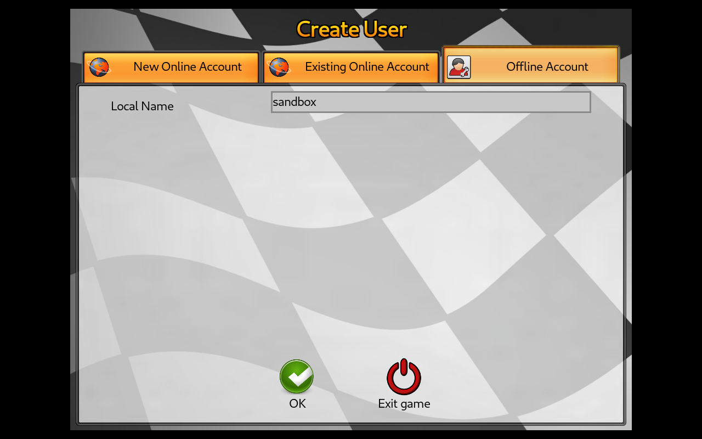

### 0 A.D.

Real-time strategy: build a civilization, raise armies, fight campaigns or multiplayer matches.

```bash
sudo apt install 0ad && 0ad
```

- **Licence:** GPL-2.0+ (code), CC-BY-SA-3.0 (data) per the package copyright file.
- **Tested (7 Nov 2026):** 0ad 0.0.25b-2. The game launched, opened its window and initialised its engine (confirmed in its log), and stayed running. The main menu had not finished drawing after ~95 seconds under software rendering, so this is launch-level evidence only. **Modified-environment result:** 0 A.D. refuses to start as root, and our isolation namespace maps the test user to root, so for this one game we presented a non-root user id via an `LD_PRELOAD` shim. On a normal desktop install none of that applies.
- **Version note:** Ubuntu 22.04 carries 0.0.25b ("Alpha 25b"); upstream's current release is Release 28 "Boiorix" (per https://play0ad.com/download/, checked 7 Nov 2026) - three releases ahead, so expect meaningful differences.
- **Upstream:** https://play0ad.com

### OpenTTD

The open-source successor to Transport Tycoon Deluxe: build rail, road, air and shipping networks.

```bash
sudo apt install openttd openttd-opengfx openttd-opensfx && openttd
```

- **Licence:** GPL-2.0 (per the package copyright file); the OpenGFX/OpenSFX content packs are free as well.
- **Tested (7 Nov 2026):** openttd 12.1-2build1 with openttd-opengfx 7.1-1 and openttd-opensfx 1.0.3-2. Starting a new game directly (`openttd -g`) generated a map and reached the in-game UI (toolbar, date, treasury). The game warned "no compatible GPU found, hardware acceleration disabled" - expected in our no-GPU test environment; it renders in software.
- **Catches:** the base `openttd` package ships no graphics or sound - install the two content packages as in the command above, or use the in-game online content downloader. Music playback additionally needs a General MIDI soundfont (the `timgm6mb-soundfont` package is pulled in by this install; on minimal systems music may stay silent).
- **Version note:** Ubuntu 22.04 carries 12.1; upstream's latest stable is 15.3 (per https://www.openttd.org, checked 7 Nov 2026). Savegames and multiplayer are version-sensitive.
- **Upstream:** https://www.openttd.org

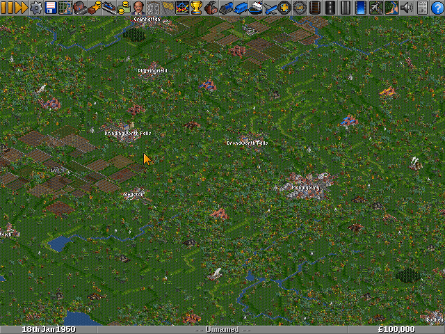

### Battle for Wesnoth

Turn-based strategy on hex maps: sixteen official campaigns, plus online multiplayer.

```bash
sudo apt install wesnoth && wesnoth
```

- **Licence:** GPL-2.0+ (per the package copyright file).
- **Tested (7 Nov 2026):** wesnoth 1:1.16.2-2. Main menu rendered (version 1.16.2 shown). On a real install the `wesnoth` command is an alternatives symlink to `wesnoth-1.16` created by the package's postinst; our extraction method skips maintainer scripts, so in the test we launched `wesnoth-1.16` directly.
- **Version note:** Ubuntu 22.04 carries 1.16.2; upstream's stable branch is 1.18.x (latest 1.18.8 per the official release announcements, checked 7 Nov 2026).
- **Upstream:** https://www.wesnoth.org

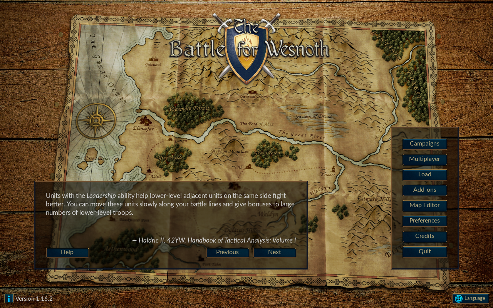

### Minetest

Open voxel sandbox: mining, building, survival, mods and multiplayer servers.

```bash
sudo apt install minetest && minetest
```

- **Licence:** LGPL-2.1+ (engine); bundled game content CC-BY-SA-3.0/MIT (per the package copyright files).
- **Tested (7 Nov 2026):** minetest 5.4.1+repack-2build1. Started a fresh world directly (`minetest --go`): spawned into a generated snowy landscape with the hearts/hotbar HUD and walked forward under simulated keyboard input. The main menu also rendered in a separate run.
- **Version note:** upstream renamed the project to **Luanti** and is at 5.17.0 (per https://www.luanti.org, checked 7 Nov 2026). Ubuntu 22.04's minetest 5.4.1 is far behind; some multiplayer servers require a newer client.
- **Upstream:** https://www.luanti.org

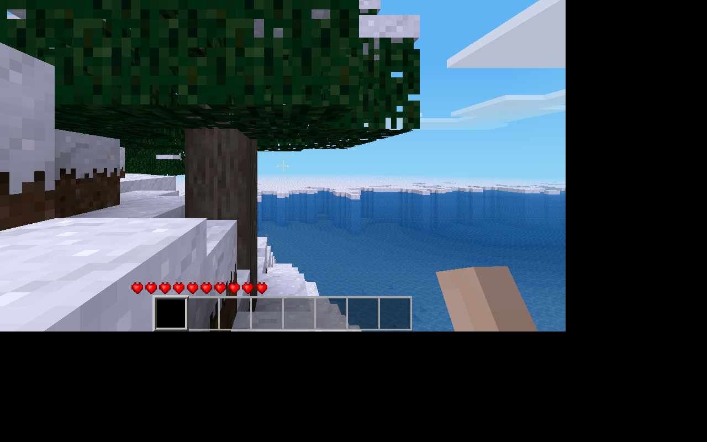

### Endless Sky

Space trading, combat and exploration in the style of Escape Velocity, with a long story campaign.

```bash
sudo apt install endless-sky && endless-sky
```

- **Licence:** GPL-3+ (code); data CC-BY-SA-4.0 and other free licences (per the package copyright files).
- **Tested (7 Nov 2026):** endless-sky 0.9.8-1.2. Main menu rendered with version shown; pilot creation is one click past it.
- **Version note:** Ubuntu 22.04 carries 0.9.8; upstream's latest stable is v0.11.4 (per https://github.com/endless-sky/endless-sky/releases/latest, checked 7 Nov 2026).
- **Upstream:** https://endless-sky.github.io

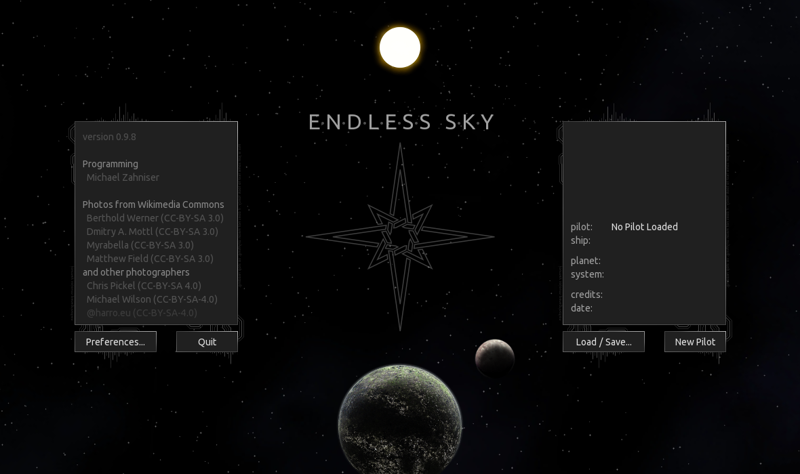

### SuperTux

A Mario-style jump-and-run with a full story mode across two worlds.

```bash
sudo apt install supertux && supertux2
```

- **Licence:** GPL-3+ (code); data CC0/OFL and other free licences (per the package copyright files).
- **Tested (7 Nov 2026):** supertux 0.6.3-1. Intro cutscene and menus rendered and responded to simulated keys; we navigated Start Game > Story Mode to the world map.
- **Catch:** the run command is `supertux2`, not `supertux`.
- **Version note:** 0.6.3 is also the current upstream release (per https://supertux.org/download.html, checked 7 Nov 2026).
- **Upstream:** https://supertux.org

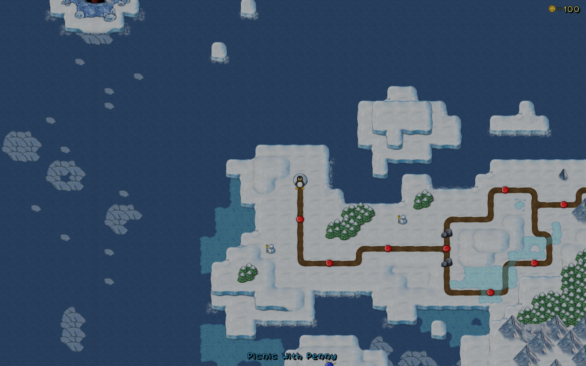

### Hedgewars

Turn-based artillery battles with hedgehogs: solo missions, local and online multiplayer.

```bash
sudo apt install hedgewars && hedgewars
```

- **Licence:** GPL-2 (code); documentation GFDL-1.3; data CC-BY-SA-3.0 and other free licences (per the package copyright files).
- **Tested (7 Nov 2026):** hedgewars 1.0.0-16build1. Rendered its first-run dialog offering training missions, over the main menu.
- **Version note:** 1.0.0 is the current upstream release (per https://www.hedgewars.org/download.html, checked 7 Nov 2026; the source tarball carries 1.0.3 build fixes that don't change gameplay).
- **Upstream:** https://www.hedgewars.org

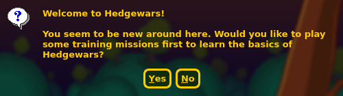

### Teeworlds

Fast 2D arena shooting with a grappling hook. Multiplayer only - there is no single-player mode.

```bash
sudo apt install teeworlds && teeworlds
```

- **Licence:** Zlib (code); data Zlib/CC0/BSD (per the package copyright files).
- **Tested (7 Nov 2026):** teeworlds 0.7.5-1. First-run language and player-name prompts, then the main menu rendered (0.7.5 shown). Finding a match needs an internet server.
- **Version note:** 0.7.5 (April 2020) is the latest official release (per https://www.teeworlds.com, checked 7 Nov 2026). The community fork DDraceNetwork (DDNet, https://ddnet.org) describes itself as actively maintained and is where most ongoing development happens.
- **Upstream:** https://www.teeworlds.com

### Freedoom Phase 2 / Crispy Doom

A complete free-content campaign for Doom II, played through the Crispy Doom engine.

```bash
sudo apt install crispy-doom freedoom
crispy-doom -iwad /usr/share/games/doom/freedoom2.wad   # or the `freedoom2` launcher
```

- **Licence:** game data under the Freedoom licence (BSD-style terms, per the package copyright file); engine GPL-2.0+.
- **Tested (7 Nov 2026):** freedoom 0.12.1-2 with crispy-doom 5.11.1-1. Launched, the menu responded to simulated keys, and the engine loaded MAP15 and entered the first-person level view with HUD. Sound initialised (dummy driver).
- **Controls:** standard Doom layout (arrows to move, Ctrl to fire, Space to use, Shift to run), configurable with `crispy-setup`. From the engine's documentation; only menu keys were exercised in our run.
- **Upstream:** https://freedoom.github.io/ and https://github.com/fabiangreffrath/crispy-doom (both reachable at test time)

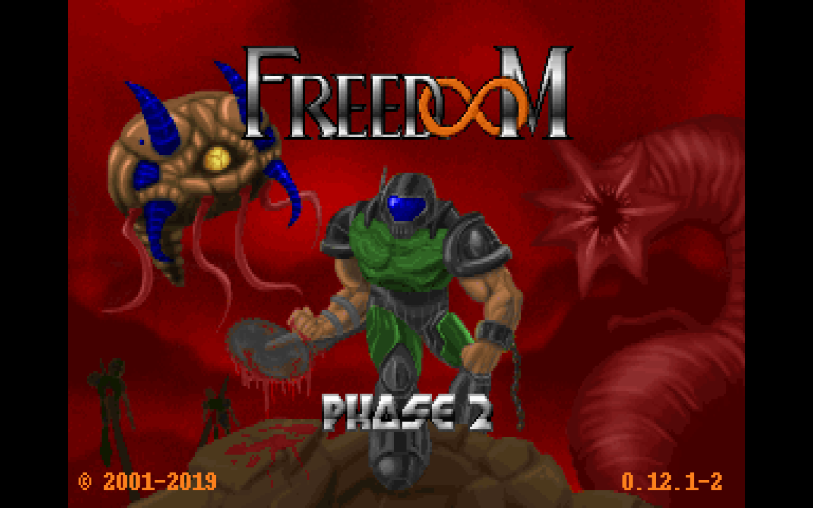
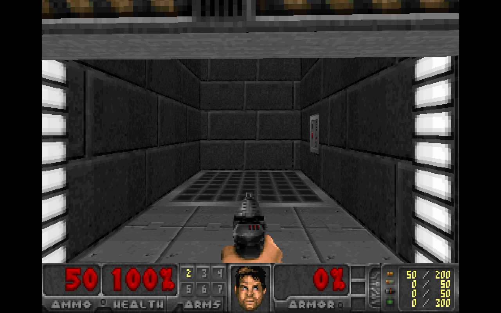


## Also tested

Twelve more games passed the same test rig on the same day. They're solid, just not the headline picks above. Quick command and verdict here; licences, full test notes and screenshots sit in the details under each game.

### Nebulus - rotating-tower platform action

```bash
sudo apt install toppler && toppler
```

Reached live gameplay (attract demo). [Details and screenshots](#details-nebulus-toppler)

### LTris - polished Tetris-style blocks

```bash
sudo apt install ltris && ltris
```

Reached live gameplay (auto-played demo; the New Game screen defaults to the "Demo" game type). [Details and screenshots](#details-ltris)

### MadBomber - catch falling bombs, Kaboom!-style

```bash
sudo apt install madbomber && madbomber
```

Reached the live game screen. [Details and screenshots](#details-madbomber)

### Vodovod - pipe puzzle against the clock

```bash
sudo apt install vodovod && vodovod
```

Reached the Level 1 board. Catch: the original site is gone; the game is maintained via Debian/Ubuntu. [Details and screenshots](#details-vodovod)

### BlockOut II - Tetris in true 3D

```bash
sudo apt install blockout2 && blockout2
```

Reached a running game (score progressing). [Details and screenshots](#details-blockout-ii)

### Alex the Allegator 4 - Game Boy-styled platformer

```bash
sudo apt install alex4 && alex4
```

Intro verified (story screens respond to keys); gameplay not reached in our automated run. [Details and screenshots](#details-alex-the-allegator-4)

### Ceferino - fast single-screen arcade

```bash
sudo apt install ceferino && ceferino
```

Intro verified. Catch: upstream site unresponsive at test time; the Ubuntu package is the reliable source. [Details and screenshots](#details-ceferino)

### Powermanga - vertical shoot 'em up

```bash
sudo apt install powermanga && powermanga
```

Launch verified (menu rendered). Catch: a starfield intro runs for several seconds before the menu appears; it's not hung. [Details and screenshots](#details-powermanga)

### Trackballs - marble-rolling 3D levels

```bash
sudo apt install trackballs && trackballs
```

Launch verified (menu over animated 3D backdrop). [Details and screenshots](#details-trackballs)

### Fillets-NG - Sokoban-like fish logic puzzles

```bash
sudo apt install fillets-ng && fillets
```

Launch verified (world-map level select). Catch: the binary is called `fillets`. [Details and screenshots](#details-fillets-ng)

### Pingus - Lemmings-style penguin puzzles

```bash
sudo apt install pingus && pingus
```

Launch verified (main menu). Catch: this is the older 0.7.x stable branch, still shipped in Debian/Ubuntu. 

--- [Details and screenshots](#details-pingus)

### Frozen Bubble - colourful bubble-popping puzzle

```bash
sudo apt install frozen-bubble && frozen-bubble
```

Reached the Level 1 game board in our test. Catch: upstream development has been dormant for years; Debian still maintains the package. [Details and screenshots](#details-frozen-bubble)

### Details: Nebulus (Toppler)


Climb a rotating tower against the clock; a remake of the classic Nebulus/Tower Toppler.

```bash
sudo apt install toppler && toppler
```

- **Licence:** GPL-2.0+ (package copyright).
- **Tested:** 1.3-1. Menu rendered; after input the game entered its attract/demo mode showing the engine playing the tower itself. Player controls not exercised.
- **Controls (packaged man page, not exercised in our run):** cursor keys move; Space or Return selects, jumps, or throws a snowball.
- **Upstream:** https://gitlab.com/roever/toppler/ (reachable at test time)

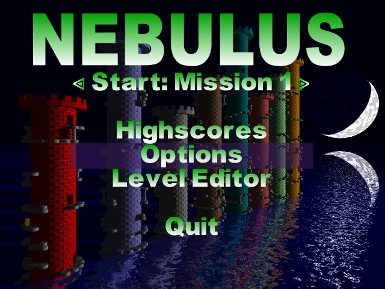
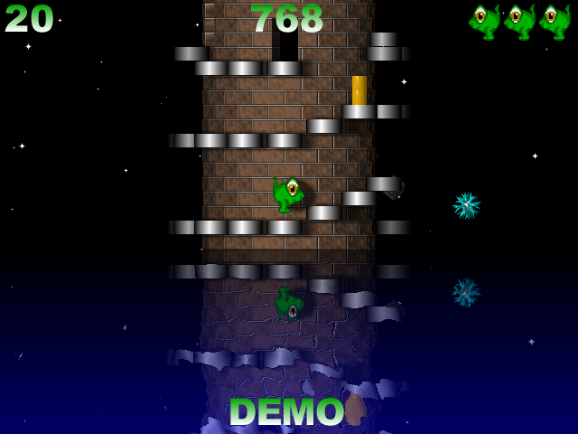

### Details: LTris


A polished Tetris-style falling-block game with a high-score chart and multiplayer options.

```bash
sudo apt install ltris && ltris
```

- **Licence:** GPL (package copyright; version text says GNU GPL, see `/usr/share/doc/ltris/copyright`).
- **Tested:** 1.0.19-3build1. Arrow keys navigated the menu into the New Game screen (verified by screenshot). Starting the default "Demo" game type launched the auto-played demo: the screenshots show the demo playing, score rising from 100 to 700 across a few seconds. Player controls not exercised.
- **Upstream:** http://lgames.sourceforge.net/index.php?project=LTris (reachable from our test network; one earlier check from elsewhere received a 403, likely bot filtering - the [package page](https://packages.ubuntu.com/jammy/ltris) is the fallback)

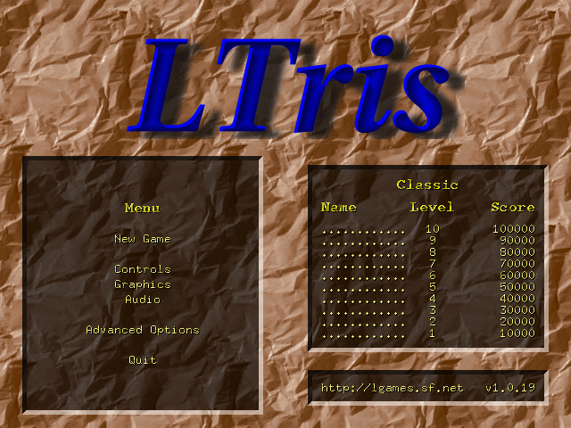
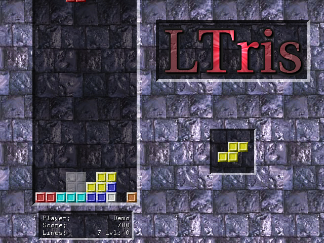

### Details: MadBomber


Kaboom!-style arcade catching: move the bucket, catch the bombs.

```bash
sudo apt install madbomber && madbomber
```

- **Licence:** GPL-2.0 (package copyright).
- **Tested:** 0.2.5-8.1. Menu rendered; selecting One Player with simulated keys reached the live game screen (bomber throwing bombs, buckets below).
- **Upstream:** http://www.newbreedsoftware.com/madbomber/ (reachable at test time)

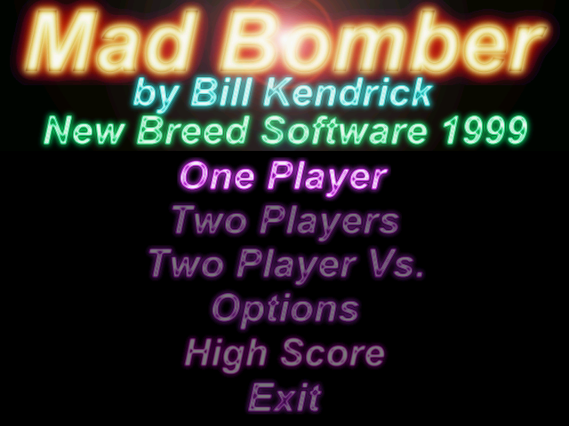
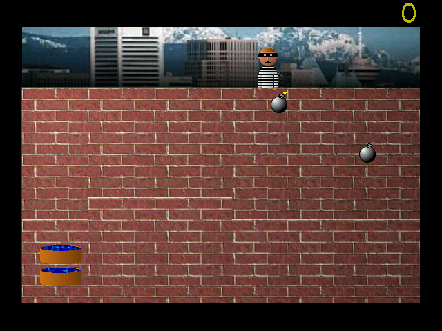

### Details: Vodovod


Connect pipes before the water starts flowing; a pipe-puzzle against the clock.

```bash
sudo apt install vodovod && vodovod
```

- **Licence:** GPL-2.0+ (package copyright).
- **Tested:** 1.10-5. Menu rendered; simulated keys started a new game and reached the Level 1 board with the pipe tray. Placing pipes (mouse work) not exercised.
- **Controls (in-game Help and packaged man page):** mouse places pipes; joystick configurable in Options. Not exercised beyond menu input.
- **Upstream:** the original project site is gone; the game is maintained in Debian/Ubuntu - https://tracker.debian.org/pkg/vodovod

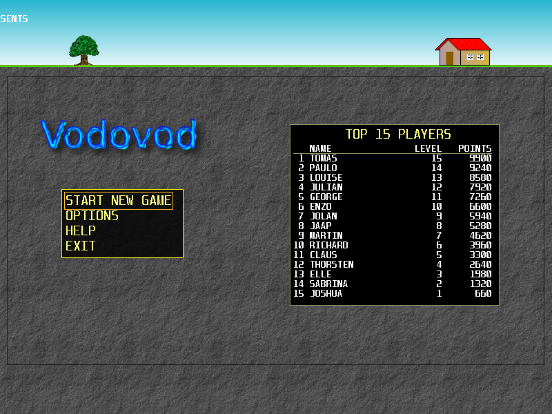
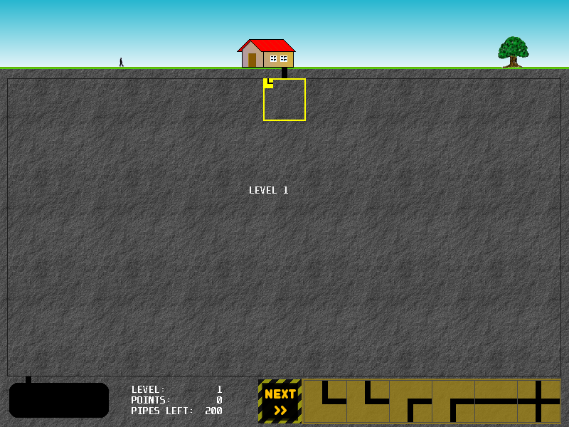

### Details: BlockOut II


Tetris in true 3D: rotate blocks in three axes and fill pits.

```bash
sudo apt install blockout2 && blockout2
```

- **Licence:** GPL-2.0+ (package copyright).
- **Tested:** 2.5+dfsg1-1build1. Menu rendered; simulated keys started a "Flat Fun" game and the run progressed (score 34, 5 cubes played at capture). How much of that progress was our input versus automatic falling is unverified.
- **Controls (packaged man page, not verified in our run):** arrows and Space move the falling piece.
- **Upstream:** http://www.blockout.net/blockout2/ (reachable at test time)

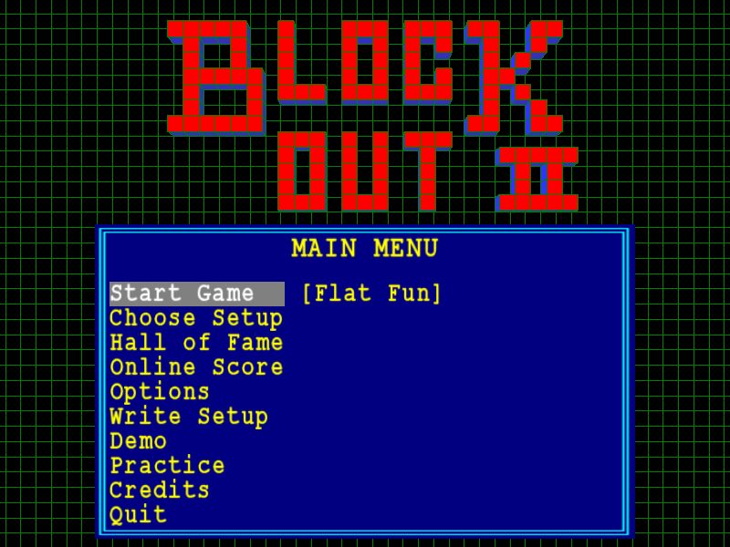
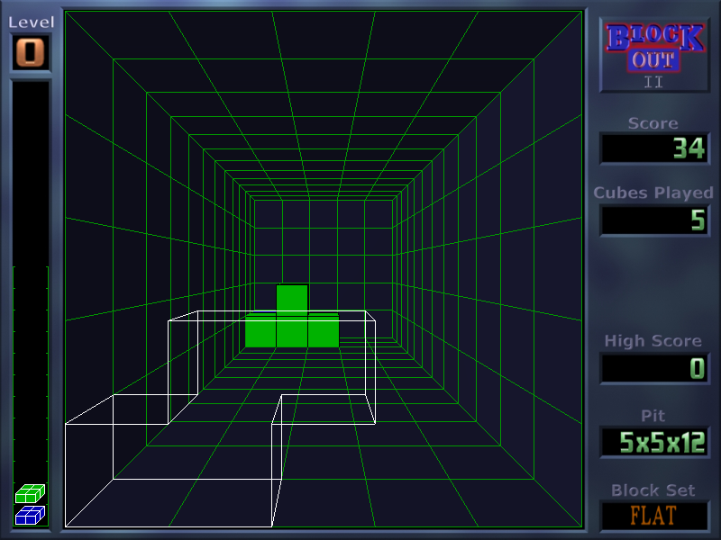

### Details: Alex the Allegator 4


A deliberately Game Boy-styled platformer: two-colour graphics, chiptune, short levels.

```bash
sudo apt install alex4 && alex4
```

- **Licence:** GPL-2.0+ (package copyright).
- **Tested:** 1.1-9. Story intro rendered and advanced in response to key presses. Actual gameplay not reached in the automated run.
- **Controls (packaged man page, not exercised):** arrow keys move; jump and shoot (shooting unlocked once you find eggs); keyboard or joystick.
- **Upstream:** http://allegator.sourceforge.net/ (reachable at test time)

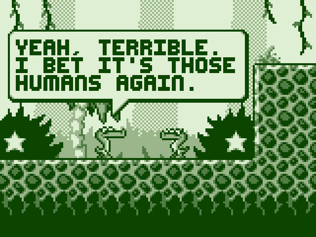
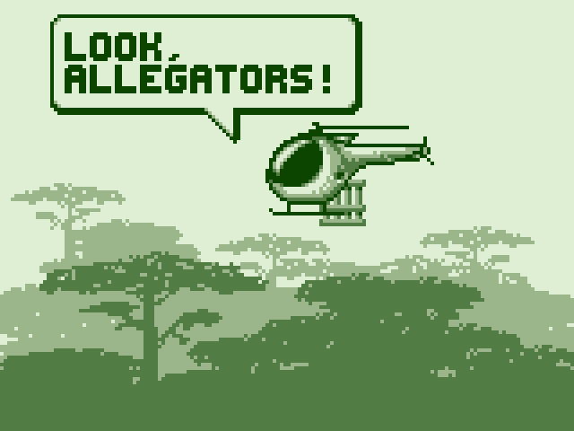

### Details: Ceferino


Fast single-screen arcade platforming from the LosersJuegos team: aliens are stealing Don Ceferino's cows.

```bash
sudo apt install ceferino && ceferino
```

- **Licence:** GPL-2.0+ (package copyright).
- **Tested:** 0.97.8+svn37-2build1. Intro and comic story screens rendered and advanced after key presses. Actual gameplay not reached in the automated run.
- **Controls (packaged man page, not exercised):** menus with arrows + Return/Space; in game, Left/Right move, Up climbs stairs, Down crouches.
- **Upstream:** http://www.losersjuegos.com.ar/juegos/ceferino did not respond at test time (we don't know whether that's temporary); use the [package page](https://packages.ubuntu.com/jammy/ceferino)

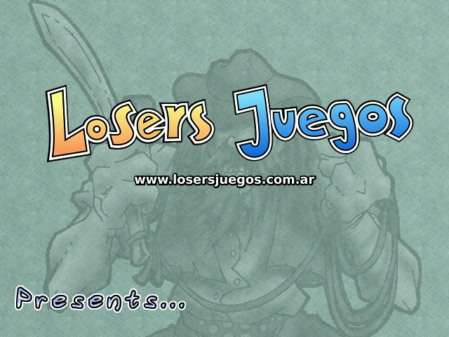
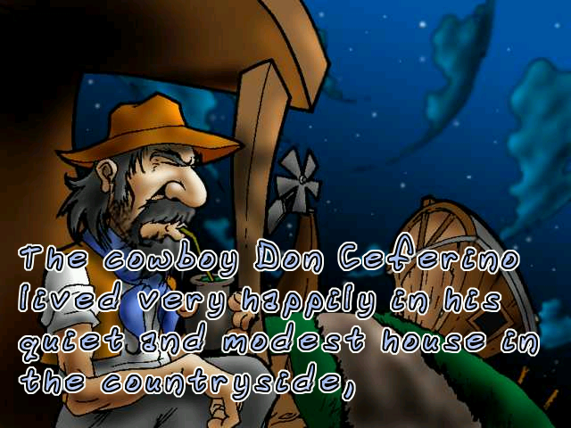

### Details: Powermanga


Vertical-scrolling arcade shoot 'em up with power-ups and big sprites.

```bash
sudo apt install powermanga && powermanga
```

- **Licence:** GPL-3.0+ (package copyright).
- **Tested:** 0.93.1-4. Launched and rendered its animated menu (PLAY / ORDER / ABOUT / QUIT). Note: a starfield intro runs for several seconds before the menu appears; first launch is not hung, just slow. Menu input not exercised.
- **Controls (packaged docs, not exercised):** arrow keys move, Space fires, Ctrl confirms; Ctrl+Q quits.
- **Upstream:** http://linux.tlk.fr/games/Powermanga/ (reachable at test time)

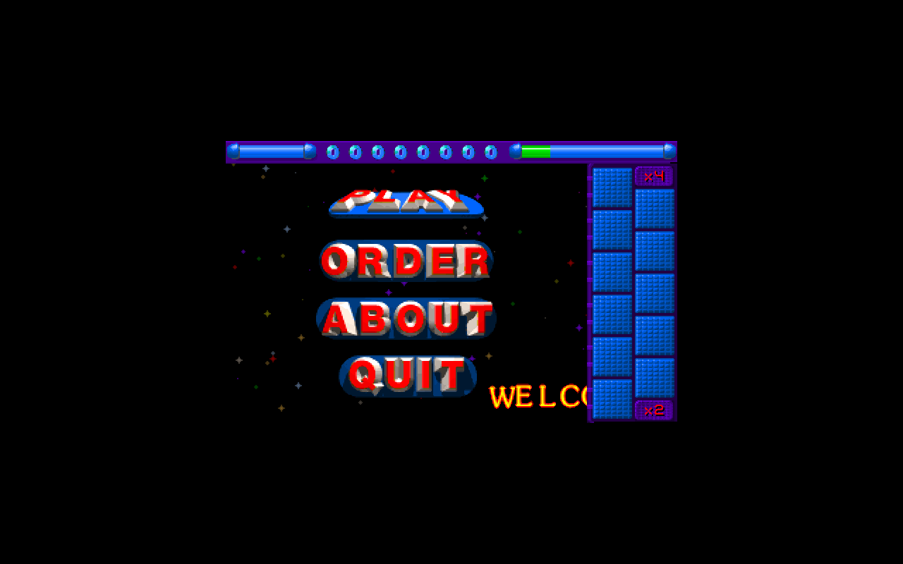

### Details: Trackballs


Guide a marble through tilted 3D levels, in the spirit of Marble Madness.

```bash
sudo apt install trackballs && trackballs
```

- **Licence:** GPL-2.0+ (game; package copyright also lists the Ethymonics Free Music License for bundled music).
- **Tested:** 1.3.3-1. Launched and rendered its menu over an animated 3D backdrop. Input response unconfirmed; gameplay not reached in the automated run.
- **Controls (packaged man page, not exercised):** mouse steers the ball; sensitivity adjustable in Settings.
- **Upstream:** https://trackballs.github.io/ (reachable at test time)

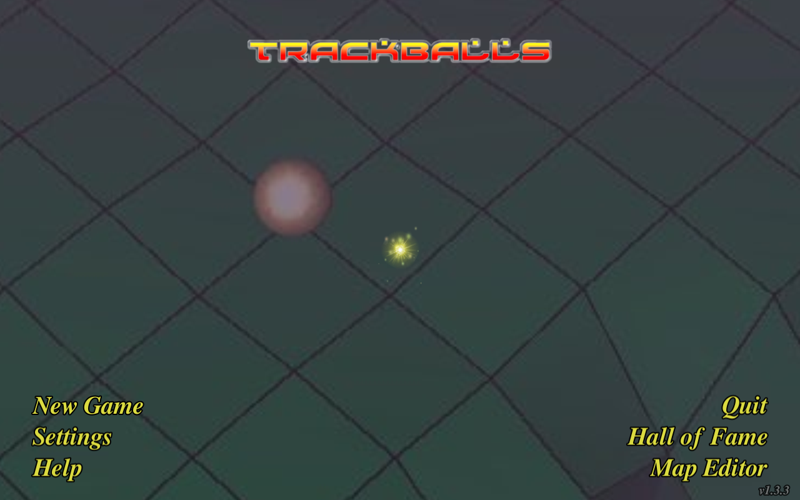

### Details: Fillets-NG


Sokoban-like logic puzzles: push objects around to free two fish, with deadpan commentary.

```bash
sudo apt install fillets-ng && fillets
```

- **Licence:** GPL-2.0 (game and data); see `/usr/share/doc/fillets-ng/copyright` for full detail including packaging terms.
- **Tested:** 1.0.1-4build2. Launched and rendered its illustrated world-map level select. Input not exercised.
- **Controls (packaged man page, not exercised):** arrow keys move the current fish, Space switches fish, Backspace restarts the level, F5 toggles the move counter.
- **Upstream:** http://fillets.sourceforge.net/ (reachable at test time)

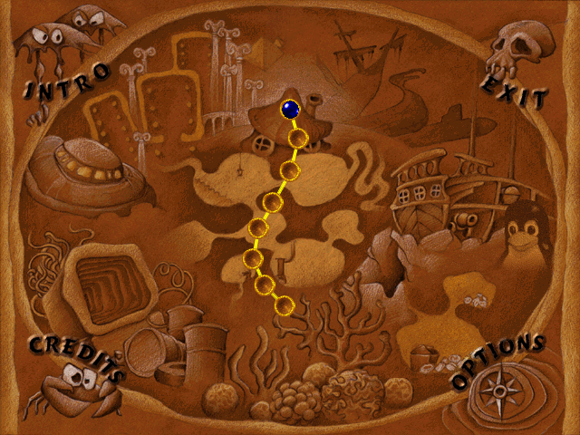

### Details: Pingus


A free Lemmings-style puzzle game with penguins: assign actions, guide the crowd to the exit.

```bash
sudo apt install pingus && pingus
```

- **Licence:** GPL-2.0+ (package copyright).
- **Tested:** 0.7.6-5.1. Launched and rendered its main menu (Story / Levelsets / Editor / Options). This is the older 0.7.x stable branch, still shipped in Debian/Ubuntu. Menu is mouse-driven; input not exercised in the automated run.
- **Upstream:** http://pingus.seul.org/ (reachable at test time)

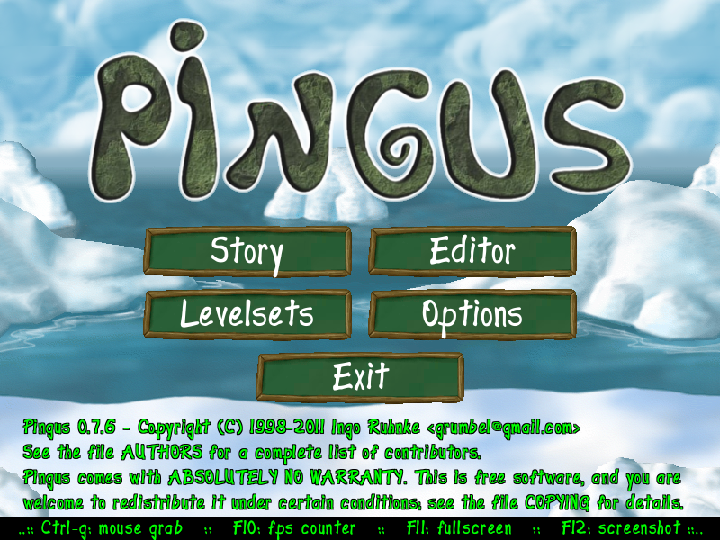

---

## How we test

For each game:

1. We resolve the full dependency closure with apt's own resolver (`apt-get install --download-only --print-uris`), so the packages tested are exactly the ones `sudo apt install` would fetch, in the same versions.
2. We extract the packages and run the game against them in an isolated filesystem namespace (overlayfs over the stock system) on Ubuntu 22.04.5 LTS, with a virtual display (Xvfb, 1280x800x24) and no audio device. This is not a literal `sudo apt install` on a desktop machine; it is a runtime test of apt's exact package set.
3. We capture screenshots from the live run and record whether the process stayed up, whether the screen responded to simulated keyboard/mouse input (xdotool), and anything that broke.
4. We read the maintainer scripts (preinst/postinst/prerm/postrm) of every package used. Across all 13 they do routine housekeeping: register menu entries/icons, one `update-alternatives` link (crispy-doom), and set up high-score storage - powermanga installs its binary setgid `root:games` (mode 2755) with score files under `/var/games/powermanga`, and toppler and ltris create `root:games` score directories/files. Our extraction test does not reproduce those ownership/permission steps, so installed high-score saving was not exercised.
5. Licence statements come from each package's own `/usr/share/doc/<package>/copyright` file (including the `-data` package where a game splits one), not from assumption.

Honest limits:

- No physical GPU and no sound card in the test environment. 3D games rendered in software; audio was disabled. Performance on real hardware will be better than anything you see here.
- Input is simulated (xdotool), not a human player. "Demo/attract mode" entries prove the game engine renders and runs a level by itself; they do not prove player controls. Where a control scheme is listed from the game's packaged documentation, it says so, and it means we did not exercise it in the automated run.
- Nothing here is a guarantee about other Ubuntu versions, Wayland sessions, or your hardware. It's a dated record of what ran, where, and how.

## Evidence levels

| Level | Meaning |
|---|---|
| **Gameplay screen reached** | Menus passed and an actual level/game screen rendered (start of play or attract/demo mode - the entry says which). |
| **Menu interaction verified** | Menu or intro screens visibly changed in response to simulated input. |
| **Launch verified** | Game launched, rendered its real menu/graphics, and stayed running. Input not exercised. |

## Notes

- Every screenshot in `screenshots/` was captured from our own test run on 7 November 2026; nothing is copied from upstream marketing material. Screenshots depict the games and remain subject to each game's own licence; they are included as test evidence.
- Every game also has an Ubuntu package page: `https://packages.ubuntu.com/jammy/<package-name>`.
- Current-LTS availability check (7 November 2026, packages.ubuntu.com): all ten headline packages exist on Ubuntu 26.04 LTS (Resolute Raccoon) - supertuxkart 1.5-2build1, 0ad 0.28.0-3, openttd 15.1-1, wesnoth 1:1.18.7-1, minetest 5.10.0+dfsg-5+deb13u1build0.26.04.1, endless-sky 0.10.16-3, supertux 0.6.3-5, hedgewars 1.0.3-4build4, teeworlds 0.7.5-3, freedoom 0.13.0-3. This is availability information only, fetched from the package index - we run-tested on 22.04, not 26.04.
- Text in this repository is MIT-licensed (see LICENSE).
- Planned next: more games, exercising real gameplay controls for every entry, a Windows edition, and re-dating entries as new Ubuntu releases land.

### Details: Frozen Bubble

Aim coloured bubbles from the penguin's launcher at the bottom; match 3 or more to drop them.

- **Licence:** GPL-2.0 (package copyright file).
- **Tested:** 2.212 (jammy). Menu rendered, we started Level 1 and the board rendered with bubbles in play above the penguin launcher.
- **Upstream:** original project dormant (last upstream release years ago); Debian's package tracker shows continued packaging maintenance.

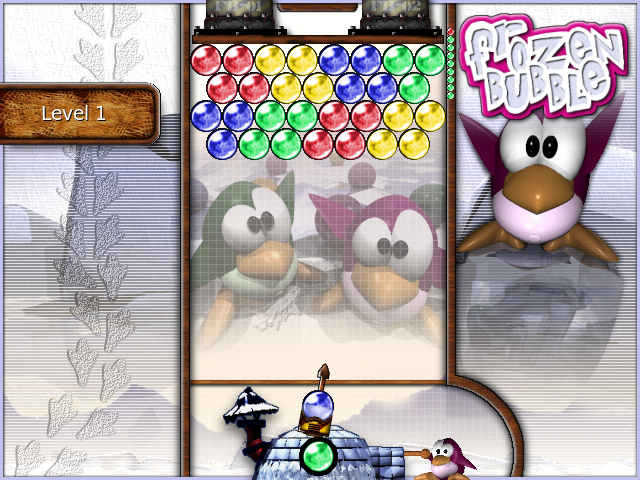

---

## How we test

For each game:

1. We resolve the full dependency closure with apt's own resolver (`apt-get install --download-only --print-uris`), so the packages tested are exactly the ones `sudo apt install` would fetch, in the same versions.
2. We extract the packages and run the game against them in an isolated filesystem namespace (overlayfs over the stock system) on Ubuntu 22.04.5 LTS, with a virtual display (Xvfb, 1280x800x24) and no audio device. This is not a literal `sudo apt install` on a desktop machine; it is a runtime test of apt's exact package set.
3. We capture screenshots from the live run and record whether the process stayed up, whether the screen responded to simulated keyboard/mouse input (xdotool), and anything that broke.
4. We read the maintainer scripts (preinst/postinst/prerm/postrm) of the game packages. They do routine housekeeping: menu entries/icons, font conffile cleanup, soundfont and command aliases via `update-alternatives` (crispy-doom, and `wesnoth` -> `wesnoth-1.16`), and high-score storage setup - powermanga installs its binary setgid `root:games` (mode 2755) with score files under `/var/games/powermanga`, and toppler and ltris create `root:games` score directories/files. Our extraction test does not run these scripts, so setgid bits, command aliases and score-file setup are not reproduced, and installed high-score saving was not exercised.
5. Licence statements come from each package's own `/usr/share/doc/<package>/copyright` file (including the `-data` package where a game splits one), not from assumption.

Honest limits:

- No physical GPU and no sound card in the test environment. 3D games rendered in software (llvmpipe); audio was disabled. Performance on real hardware will be better than anything you see here, and slow first draws in our runs are the test rig, not the game.
- Input is simulated (xdotool), not a human player. "Demo/attract mode" entries prove the game engine renders and runs a level by itself; they do not prove player controls. Where a control scheme is listed from the game's packaged documentation, it says so, and it means we did not exercise it in the automated run.
- One game (0 A.D.) additionally needed a test-only tweak: it refuses to run as root and our namespace maps the tester to root, so we presented a non-root user id via `LD_PRELOAD`. Its entry is labelled as a modified-environment result.
- Version notes compare Ubuntu 22.04's package with upstream's latest release, checked on 7 November 2026 from the linked upstream pages. "Latest" means "latest on that date"; check the upstream link for today.
- Nothing here is a guarantee about other Ubuntu versions, Wayland sessions, or your hardware. It's a dated record of what ran, where, and how.

## Evidence levels

| Level | Meaning |
|---|---|
| **Gameplay screen reached** | Menus passed and an actual level/game screen rendered (start of play or attract/demo mode - the entry says which). |
| **Menu interaction verified** | Menu or intro screens visibly changed in response to simulated input. |
| **Launch verified** | Game launched, rendered its real menu/graphics, and stayed running. Input not exercised. |

## Notes

- Every screenshot in `screenshots/` was captured from our own test run on 7 November 2026; nothing is copied from upstream marketing material. Screenshots depict the games and remain subject to each game's own licence; they are included as test evidence.
- Every game also has an Ubuntu package page: `https://packages.ubuntu.com/jammy/<package-name>`.
- Current-LTS availability check (7 November 2026, packages.ubuntu.com): all ten headline packages exist on Ubuntu 26.04 LTS (Resolute Raccoon) - supertuxkart 1.5-2build1, 0ad 0.28.0-3, openttd 15.1-1, wesnoth 1:1.18.7-1, minetest 5.10.0+dfsg-5+deb13u1build0.26.04.1, endless-sky 0.10.16-3, supertux 0.6.3-5, hedgewars 1.0.3-4build4, teeworlds 0.7.5-3, freedoom 0.13.0-3. This is availability information only, fetched from the package index - we run-tested on 22.04, not 26.04.
- Text in this repository is MIT-licensed (see LICENSE).
- Planned next: more games, exercising real gameplay controls for every entry, testing on the current Ubuntu LTS, a Windows edition, and re-dating entries as new Ubuntu releases land.
